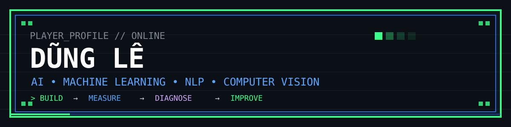
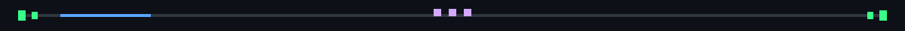

<div align="center">




<br>

<a href="mailto:dung.levc2810@gmail.com"></a>
<a href="https://github.com/Dle28"></a>


<br><br>


<br><br>



</div>



## `[ ABOUT_PLAYER ]`

```python
class DungLe:
    role = "AI Engineer in training"
    university = "Hanoi University of Science and Technology"

    focus = [
        "Computer Vision",
        "Natural Language Processing",
        "Machine Learning",
        "Data Science",
        "Quantitative Research",
    ]

    operating_system = "Linux"
    philosophy = "Build → Measure → Diagnose → Improve"
```

<div align="center">

`STATUS: LEARNING`　`MODE: BUILDING`　`BIAS: MEASURE FIRST`

</div>


## `[ TECH_INVENTORY ]`

<div align="center">

### `01 // AI + MACHINE LEARNING`


<br><br>

`Deep Learning` · `Classical ML` · `Model Evaluation` · `Feature Engineering` · `Time Series` · `Forecasting`

<br><br>

### `02 // COMPUTER VISION`


<br><br>

`Object Detection` · `Segmentation` · `OCR` · `Tracking` · `Pose Estimation` · `Image Processing`

<br><br>

### `03 // NLP + LANGUAGE AI`


<br><br>

`NER` · `Text Classification` · `Information Extraction` · `Entity Linking` · `Text Retrieval` · `Vietnamese NLP`

</div>


## `[ ENGINEERING_LOADOUT ]`

<div align="center">


<br><br>


</div>

<br>

<div align="center">

<table>
<tr>
<td align="center" width="25%"><b>AI / ML</b><br><br>Deep Learning<br>Evaluation<br>Feature Engineering<br>Experimentation</td>
<td align="center" width="25%"><b>Computer Vision</b><br><br>Detection<br>Segmentation<br>OCR<br>Tracking</td>
<td align="center" width="25%"><b>NLP</b><br><br>NER<br>Classification<br>Entity Linking<br>Retrieval</td>
<td align="center" width="25%"><b>Data / Quant</b><br><br>Pandas<br>Time Series<br>Forecasting<br>Statistics</td>
</tr>
</table>

</div>


## `[ CORE_LOOP ]`

<div align="center">

```text
┌───────────────┐     ┌───────────────┐     ┌───────────────┐
│    PROBLEM    │ ──▶ │   BASELINE    │ ──▶ │  EVALUATION   │
└───────────────┘     └───────────────┘     └───────┬───────┘
                                                    │
                                                    ▼
┌───────────────┐     ┌───────────────┐     ┌───────────────┐
│    IMPROVE    │ ◀── │    DIAGNOSE   │ ◀── │    MEASURE    │
└───────┬───────┘     └───────────────┘     └───────────────┘
        │
        └──────────────────────▶ REPEAT
```

`while curious: build(); measure(); diagnose(); improve()`

</div>


## `[ GITHUB_TELEMETRY ]`

<div align="center">


<br><br>


<br><br>


</div>


<div align="center">


<br>

### `AI × MATHEMATICS × ENGINEERING`

<sub>CAT_PROCESS: RUNNING // NEXT EXPERIMENT: READY</sub>

<br><br>

<a href="mailto:dung.levc2810@gmail.com"></a>

<br><br>

`[ EOF ]`

</div>
