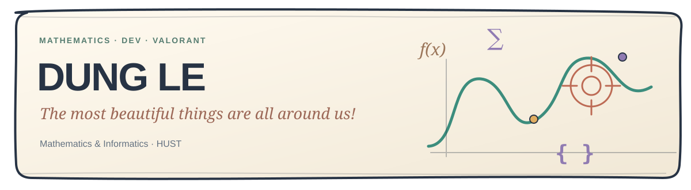
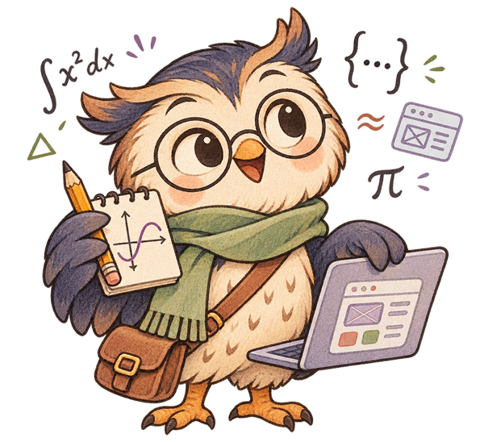
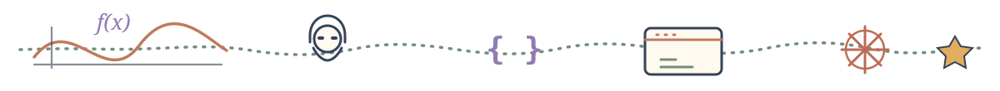
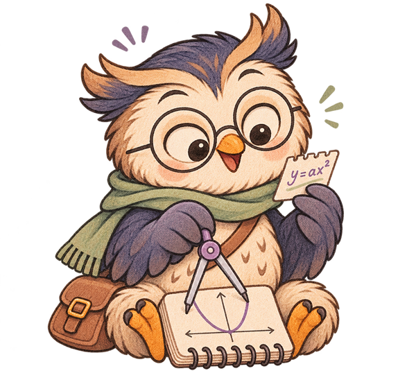
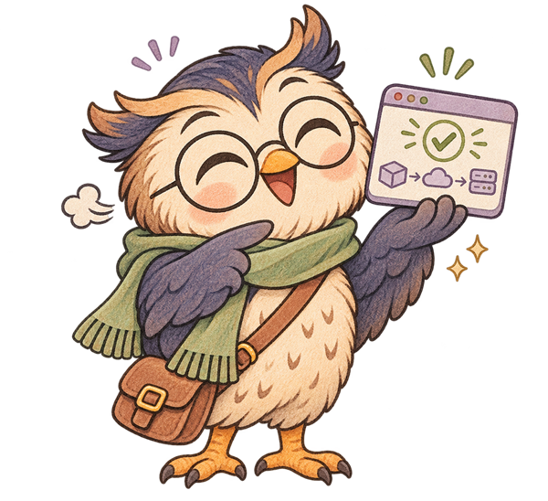

## About

I'm Dung Le, a Mathematics and Informatics student at Hanoi University of Science and Technology. I enjoy turning mathematical ideas into useful software and clear interfaces.

## Mathematics

Numerical methods · Linear algebra · Probability &amp; statistics · Optimization · Algorithms

## Interfaces

UI design · Responsive layouts · Data visualization · HTML · CSS · TypeScript

## Toolbox

**Languages &amp; programming**

**Math &amp; data**

## Systems &amp; DevOps

Linux · Git/GitHub · Docker · GitHub Actions · CI/CD · Deployment

## Star this profile

## Contact

