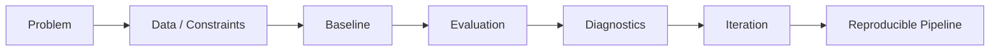

<div align="center">

# Dũng Lê

### AI Engineer in training · Computer Vision · NLP · Applied Machine Learning


<p>
  <a href="mailto:dung.levc2810@gmail.com"></a>
  <a href="https://github.com/Dle28"></a>
  
</p>

<sub>Mathematics & Informatics @ Hanoi University of Science and Technology</sub>

</div>

---

## About Me

I build practical AI systems from **data and modeling to evaluation and deployment-oriented pipelines**. My current work is centered on **Computer Vision, NLP, forecasting, and quantitative problem solving**.

```text
$ whoami
> Dũng Lê
> Mathematics & Informatics student @ HUST
> AI / ML builder
> Interested in systems that are measurable, modular, and reproducible
```

What I care about:

- Turning research ideas into complete, testable pipelines.
- Understanding model behavior instead of treating models as black boxes.
- Designing modular code that can be improved without rewriting the whole system.
- Using mathematics, experiments, and diagnostics to drive decisions.

---

## Featured Projects

<table>
<tr>
<td width="50%" valign="top">

### Clinical NLP Pipeline

<a href="https://github.com/Dle28/Viettiel_medical_nlp"><b>Viettel Clinical NLP</b></a>

Vietnamese clinical NLP pipeline designed around offset-safe processing and competition-style reproducibility.

`NER` `Assertions` `Candidate Linking` `Rule-based NLP` `Python`

**Pipeline**

```text
clinical text
   ↓
offset-safe preprocessing
   ↓
entity extraction
   ↓
assertion resolution
   ↓
candidate linking
   ↓
validated submission
```

</td>
<td width="50%" valign="top">

### Revenue Forecasting

<a href="https://github.com/Dle28/Model-predict-Revenue"><b>DATATHON Forecast Pipeline</b></a>

End-to-end forecasting workflow for Revenue and COGS with reusable marts, diagnostics, backtesting, and submission generation.

`XGBoost` `Pandas` `SHAP` `Time Series` `Forecasting`

**Focus**

```text
raw business data
   ↓
daily / weekly marts
   ↓
forecast models
   ↓
diagnostics + backtest
   ↓
submission
```

</td>
</tr>
<tr>
<td width="50%" valign="top">

### Decentralized Booking

<a href="https://github.com/Dle28/Kalenda"><b>Kalenda</b></a>

A decentralized time-booking platform on Solana with real on-chain payments, wallet integration, and a responsive web interface.

`Solana` `Next.js` `TypeScript` `Web3` `Phantom Wallet`

</td>
<td width="50%" valign="top">

### Current Direction

I am especially interested in building systems where multiple components must work together reliably:

- Computer Vision pipelines
- OCR and screen understanding
- Vietnamese NLP
- Quantitative modeling
- Efficient inference and model evaluation

</td>
</tr>
</table>

---

## Technical Toolbox

<div align="center">


<br><br>


</div>

---

## How I Build



I prefer a project structure where **state, models, use-cases, controllers, and UI/integration layers remain separable**. This makes experimentation faster and prevents one feature from turning the whole codebase into a monolith.

---

## GitHub Activity

<div align="center">


<br>


</div>

---

<div align="center">

### Build → Measure → Diagnose → Improve

<sub>Interested in AI, Computer Vision, NLP, quantitative research, or building something technically difficult? Feel free to reach out.</sub>

<br><br>

<a href="mailto:dung.levc2810@gmail.com"></a>

</div>
